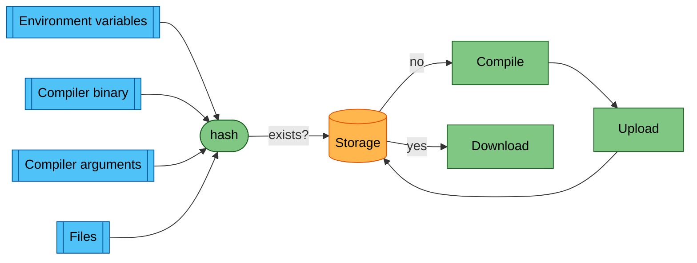
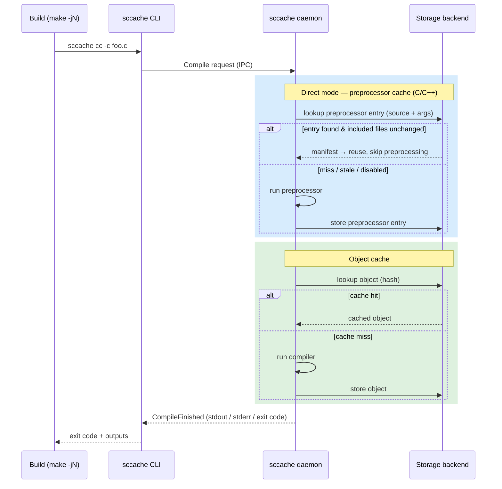
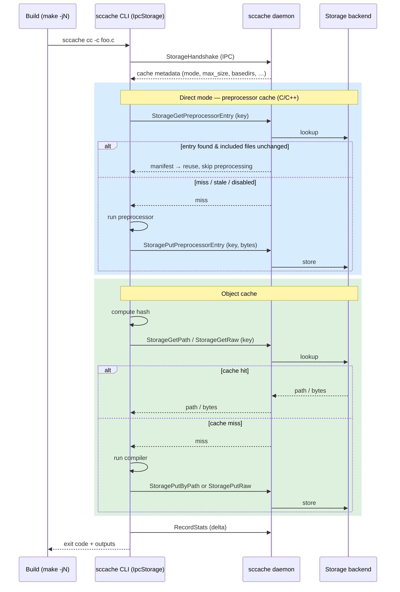

# Sccache high level architecture

This schema shows at a high level how sccache decides whether to compile or to
reuse a cached result.

For more details about how hash generation works, see [the caching documentation](Caching.md).

## Direct mode (preprocessor cache)

For C/C++, sccache can also cache the *preprocessor* result, so that a cache
lookup can skip preprocessing entirely. This is inspired by
[ccache's direct mode](https://ccache.dev/manual/3.7.9.html#_the_direct_mode)
and is described in the [local storage doc](Local.md).

Before computing the object-cache key, sccache looks up a **preprocessor cache
entry** keyed on the source file (path + contents) and the preprocessor
arguments. That entry records every file included by the source. If the entry
exists and all of those included files are unchanged, sccache reuses it and
never runs the preprocessor; otherwise it preprocesses normally and stores a
fresh entry. This step is shown as the blue region in the diagrams below and is
enabled by default (it is skipped for non-C/C++, when disabled, or when certain
flags such as `-Wp,*` / `-Xpreprocessor` are present).

## Execution modes

The caching logic above is the same regardless of *where* it runs. What differs
is which process actually runs the compiler and talks to the storage backend.

sccache is split in two:

- a short-lived **CLI process**, spawned once per compiler invocation (e.g. by
  `make -jN`), and
- a long-lived **daemon** (the background server), which holds the storage
  backend and the accumulated statistics.

The two communicate over a local IPC connection. There are two ways to divide
the work between them.

### Server-side mode (default)

The CLI forwards the whole compilation to the daemon. The daemon runs the
direct-mode preprocessor cache lookup, computes the hash, looks up the object
cache, runs the compiler on a miss, and stores the result. It writes the output
files (e.g. the object file) to disk itself; only the output streams (stdout /
stderr) and the exit code travel back to the CLI.

### Diagnosing compile delays

`sccache --show-stats` and `--show-adv-stats` report the daemon's jobserver
capacity, the number of subprocesses waiting for and holding tokens, the
oldest active wait, and the total, maximum and number of waits over 10 seconds.
Compiler probes and preprocessors also take tokens. Failed or cancelled
acquisitions contribute the time they spent waiting. The daemon warns once a
wait passes 30 seconds, at most once per minute across all waits.
On Unix, the daemon also reports tokens currently in use in its private
jobserver. This includes extra tokens acquired by rustc's codegen threads.
The gauge is omitted for inherited jobservers such as Cargo's FIFO because
their total capacity is unknown. It is also omitted on Windows.

A compiler killed while it holds tokens from the daemon's jobserver, because
its client disconnected or the kernel's OOM killer ended it, never returns
them, so the pool can shrink until no compile can start. Where the gauge of
tokens in use is reported, the stats also report how long compiles have waited
with none running, and past 60 seconds the daemon logs an error once a minute.
Restarting the daemon recovers the pool. It is not repaired in place, because
the killed compiler's descendants may still hold its tokens and return them
later.

The same stats show active work and elapsed time for request dispatch, compiler
and task setup, hashing and preprocessing, cache lookup and restore, waits for
pending writes, Rust miss logging, and distributed job setup. Cache lookup
time includes storage queues and locks. Client-side mode contributes its daemon
cache requests to these timings. Its subprocesses use the client's jobserver.
Queue telemetry covers the lifetime of the daemon, including across `--zero-stats`.

For daemon-side Rust compiles, a hashing stage over 30 seconds or a cache
lookup and restore stage over 10 seconds logs a warning on completion. Each
stage can warn at most once per minute. The warning includes the crate name,
the files and bytes hashed for the request, the longest measured blocking-pool
queue wait, the sum of completed blocking-task runtimes, and the request's
remaining queued blocking tasks. Stage elapsed time also includes work outside
the blocking pool, such as compiler subprocesses and remote cache requests.

`--stats-format=json` exposes these measurements as `stats.compile_queue`.

### Client-side mode (`SCCACHE_CLIENT_SIDE`)

The compile pipeline runs **in the CLI process itself**; the daemon is used only
as a shared gateway to the storage backend (and as a place to aggregate stats).

On startup the CLI performs a one-shot `StorageHandshake` to fetch the cache
metadata (cache mode, max size, basedirs, preprocessor-cache config, and
support for aligned raw objects and stores by path). It then
runs the same pipeline locally — including direct mode — and forwards each
individual cache operation to the daemon over IPC. On the client side this is
implemented by `IpcStorage`, which implements `CacheStorage` and
`PreprocessorCacheStorage` so the compile pipeline uses the same interfaces
in both modes.

`StorageGetPath` lets the CLI read a cached entry straight off disk when the
backend exposes a local path; for backends that don't (S3, Redis, …) the CLI
falls back to fetching the raw bytes with `StorageGetRaw`. Direct-mode entries
are exchanged with `StorageGetPreprocessorEntry` / `StoragePutPreprocessorEntry`.
For a [same-user Unix socket with a reflink disk cache](Local.md#reflink-cache-hits),
`StoragePutByPath` lets the daemon clone outputs into the cache entry.
Because each CLI process accumulates its own statistics, it flushes them to the
daemon with `RecordStats` before exiting.

Client-side mode is enabled with the `SCCACHE_CLIENT_SIDE` environment variable
(or the `client_side_mode` config key). It is expected to become the only
supported configuration in the future, with server-side mode eventually
removed. It is currently mutually exclusive with:

- **logging** (`SCCACHE_LOG`): the client always logs to stderr, ignoring `SCCACHE_ERROR_LOG`
  (concurrent CLI processes would race on a shared log file), and
- **distributed compilation** (a configured scheduler URL).

If either is in use, the setting is ignored and sccache stays in server-side
mode.

Set `SCCACHE_CLIENT_SIDE=required` to keep compiler processes inside the
caller's cgroup. This mode rejects logging and distributed compilation. If
the daemon enables miss diagnostics, the client still compiles locally and
uses it as a cache gateway.
